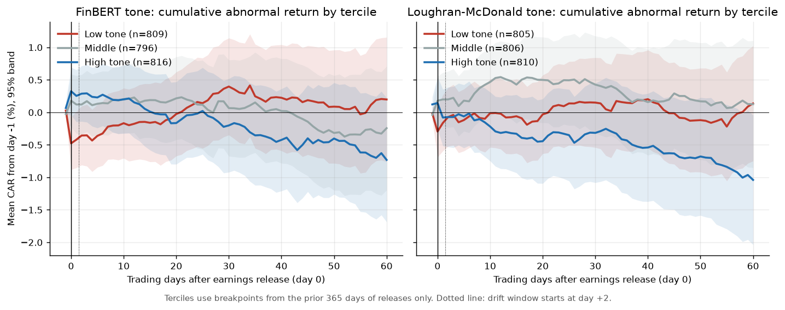
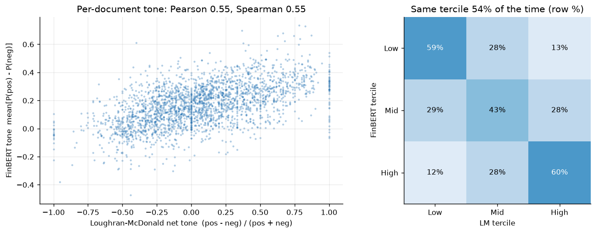
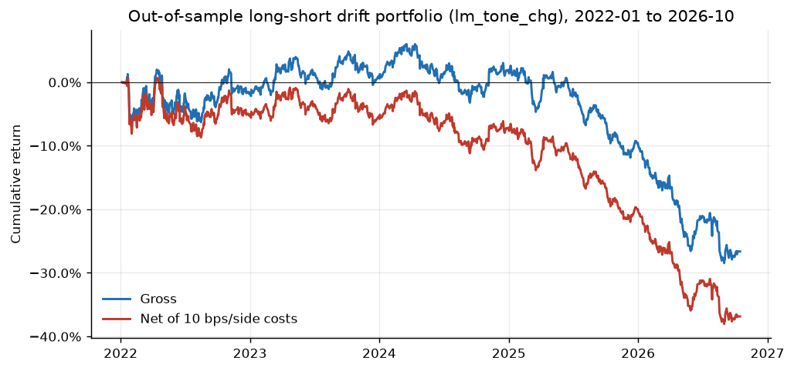

# Filing Tone Alpha: full write-up

**Question.** Does the tone of a company's earnings press release, scored by a finance-tuned language model, predict the stock's return after the release?

**Answer from this sample (2,482 releases, 75 large caps, 2018-2026).** Tone is priced *on arrival*: a one-standard-deviation rise in FinBERT tone relative to the firm's own recent releases goes with a +61 bp higher abnormal return over days [0,+1] (t = 4.58). It does **not** predict drift afterwards. Once the day [0,+1] reaction is controlled for, no tone measure predicts CAR[+2,+60], and the long-short drift portfolio picked on 2018-2021 data lost 9.2% a year after costs in 2022-2026 (Newey-West t = -2.12).



All numbers below come from `results/summary.json`, `results/tables.md` and the CSVs next to them, written by `python run.py`.

---

## 1. Data

| Item | Source | Detail |
|---|---|---|
| Earnings releases | SEC EDGAR submissions API + filing indexes | Every original 8-K with Item 2.02 ("Results of Operations") filed 2018-01-01 to 2026-07-15 by 75 long-listed S&P 500 large caps (list in `src/tone/config.py`). The press release is the EX-99.1 exhibit (else the first EX-99.x). At most one release per firm per 45 days. |
| Sample size | `results/summary.json` | 2,524 Item 2.02 filings, 2,507 with an exhibit, **2,482 events** with enough prose and full return windows. 282-297 events per full year; 157 in 2026. |
| Sentiment dictionary | [Loughran-McDonald Master Dictionary 1993-2025](https://sraf.nd.edu/loughranmcdonald-master-dictionary/) (official CSV from SRAF, Notre Dame) | Positive and Negative lists. |
| Language model | [ProsusAI/finbert](https://huggingface.co/ProsusAI/finbert) | Run locally on Apple MPS. |
| Prices | yfinance (keyless) | Daily dividend- and split-adjusted closes for the 75 stocks and SPY from 2016-09. |
| Share counts (size control) | SEC XBRL `companyconcept` API | Cover-page shares outstanding; fallbacks to balance-sheet or diluted weighted-average shares. |

EDGAR requests carry the User-Agent `Teymur Eyvazov teymur.eyvazov001@umb.edu` and are throttled to 8 per second across threads. Everything downloaded is cached gzip-compressed in `data/` (git-ignored), so re-runs make no network calls.

**Timing of day 0.** EDGAR's `acceptanceDateTime` is UTC. The sample shows it plainly: acceptance hours cluster at 10-11h and 20-21h UTC, which are about 6-7am and 4pm New York time. Times are converted to New York time. A release accepted at or after 16:00 ET gets day 0 = the next trading day, otherwise the same day. 37% of releases came after the close.

## 2. Measuring tone

**Text.** Each exhibit is converted from HTML to text. Numeric tables (digit-to-letter ratio at or above 8%) are dropped, while layout tables that hold prose are kept. The text is split into sentences, and only "narrative" sentences survive: 6-80 words, at least 60% alphabetic tokens, and no boilerplate (forward-looking-statement and safe-harbor language, non-GAAP reconciliation notes, webcast logistics, URLs). Both models see the same sentences: the first 120 narrative sentences of each release (median 92). The headline and management commentary come first in these releases.

**Loughran-McDonald (LM).** Net tone = (positive − negative) / (positive + negative) word counts. Following LM (2011), a positive word within three words after a negator (*no, not, none, neither, never, nobody*) is not counted. The median document has 37 sentiment words out of about 1,860.

**FinBERT.** Each sentence gets P(positive), P(negative) and P(neutral). Document tone = mean over sentences of P(positive) − P(negative). Sentences are batched 32 at a time and sorted by length to minimise padding.

**Tone change.** Firms have house styles: some always sound upbeat. Each measure is therefore also used as a *change*: tone minus the mean of the same firm's previous four releases (at least two required). This uses past data only.

### LM vs FinBERT



| Agreement statistic | Value |
|---|---|
| Pearson correlation of document tone | 0.55 |
| Spearman correlation | 0.55 |
| Correlation of tone *changes* | 0.51 |
| Same tercile (trailing breakpoints) | 54% |

The two measures agree on direction but are far from interchangeable. LM's net tone piles up at exactly −1, 0 and +1 because many releases contain few dictionary words. FinBERT reads whole sentences, so "revenue declined less than expected" is not simply negative to it.

## 3. Event study

- **Abnormal return:** market model against SPY, AR = r − (α + β·r_SPY). α and β come from OLS over trading days [−250, −30] with at least 120 valid days.
- **CAR windows:** [0,+1] (announcement reaction), [+2,+20] and [+2,+60] (post-announcement drift). CARs are winsorised at 1%/99%.
- **Controls:** log market cap at day −2 (unadjusted price × latest share count filed before the event), 12-1 month momentum, and the prior 20-day return. The drift regressions also control for **CAR[0,+1]**, the market's own reading of the news. This stands in for an earnings-surprise measure, because analyst consensus is not available without a paid feed.
- **Regressions:** OLS with calendar-quarter fixed effects. Standard errors are two-way clustered by firm and quarter. Tone is standardised, so the coefficient is the CAR change for a 1 s.d. move in tone.

## 4. Results

### 4.1 Cross-sectional regressions (bp of CAR per 1 s.d. of tone, t in parentheses)

| Tone measure | CAR[0,+1] | CAR[+2,+20] | CAR[+2,+60] | N |
|---|---|---|---|---|
| LM tone (level) | +5.4 (+0.51) | -3.7 (-0.32) | +14.8 (+0.53) | 2412 |
| FinBERT tone (level) | +33.2 (+2.93) | -21.0 (-1.39) | +5.3 (+0.23) | 2412 |
| LM tone, joint model | -15.8 (-1.51) | +9.6 (+0.66) | +16.4 (+0.53) | 2412 |
| FinBERT tone, joint model | +41.4 (+3.89) | -26.0 (-1.39) | -3.3 (-0.13) | 2412 |
| LM tone change | +35.8 (+2.50) | -8.6 (-1.04) | -36.4 (-1.50) | 2268 |
| FinBERT tone change | +61.1 (+4.58) | -29.7 (-2.15) | -29.4 (-0.90) | 2268 |

Reading the table:
1. **Announcement window.** FinBERT tone is priced and LM level tone is not. When both enter together, FinBERT keeps all the explanatory power (t = 3.89) and LM's sign flips. Tone *changes* are stronger than levels for both models. The FinBERT change is the strongest single variable (t = 4.58).
2. **Drift windows.** Once CAR[0,+1] is controlled for, no coefficient on CAR[+2,+60] is distinguishable from zero. The only |t| > 2 is FinBERT change on [+2,+20] (t = −2.15), and its sign points to slight *reversal*, not continuation. With six measures and three windows, one t-stat of about 2 is what chance alone delivers.

### 4.2 Tercile sorts (mean CAR %, terciles from the prior 365 days of releases only)

| Signal | Window | Low | High | High−Low | t (quarter-clustered) |
|---|---|---|---|---|---|
| FinBERT tone | [0,+1] | -0.45 | 0.21 | +0.66 | +3.42 |
| FinBERT tone | [+2,+60] | 0.57 | -0.96 | -1.53 | -2.48 |
| FinBERT change | [0,+1] | -0.73 | 0.76 | +1.49 | +5.41 |
| FinBERT change | [+2,+60] | 0.99 | -0.61 | -1.60 | -2.15 |
| LM tone | [0,+1] | -0.15 | -0.19 | -0.04 | -0.13 |
| LM tone | [+2,+60] | 0.29 | -0.88 | -1.17 | -1.69 |

The full table, including middle terciles and the [+2,+20] window, is in `results/tables.md`. The raw sorts show the same pattern as the chart: high-tone releases earn more on days 0-1 and then give some of it back. The [+2,+60] spreads are negative, with t of about −2 to −2.5. That reversal does **not** survive the regression controls (4.1) and does not survive out of sample (4.3), so it is not treated as a finding.

### 4.3 Is post-announcement drift tradable? (out-of-sample)

**Protocol.**
- Four candidate signals: LM and FinBERT, each as a level and as a change.
- Each event is assigned a tercile using breakpoints from the prior 365 days only.
- The portfolio goes long the top tercile and short the bottom tercile at the close of day +1 and holds through day +60. It is equal-weighted within each leg and runs in calendar time.
- Costs are 10 bp per side on daily one-way turnover.
- The signal is **chosen on 2018-2021 only**, by the training-period high-minus-low t-stat on CAR[+2,+60]. It is then evaluated untouched on 2022-2026.

| Signal | Period | Ann. return gross | t (NW) | Ann. return net | t (NW) | Sharpe net |
|---|---|---|---|---|---|---|
| LM tone change (chosen) | train 2018-21 | +4.8% | +1.01 | +1.5% | +0.31 | +0.16 |
| LM tone change (chosen) | **test 2022-26** | **-6.1%** | -1.42 | **-9.2%** | **-2.12** | **-1.00** |
| FinBERT tone | test 2022-26 | +5.7% | +1.44 | +2.6% | +0.66 | +0.29 |
| FinBERT tone change | test 2022-26 | -5.3% | -1.22 | -8.4% | -1.93 | -0.88 |
| LM tone | test 2022-26 | -2.8% | -0.88 | -5.9% | -1.84 | -0.72 |

No signal was significant in training. The best training t-stat was +0.81, and the selection rule still had to pick one. The chosen signal lost money out of sample. Costs take about 3 percentage points a year: average daily one-way turnover is 12.5% across both legs. Even the best signal in hindsight (FinBERT level, +2.6% net, t = 0.66) is indistinguishable from zero. **Nothing survives.**



## 5. What did not work

- **The drift hypothesis itself.** Tone does not lead to continued drift in these 75 mega caps. Whatever the language says gets priced within two days.
- **LM level tone** predicts nothing in any window. Its information shows up only as a *change* against the firm's own history (t = 2.50 on [0,+1]).
- **The apparent tone reversal** in the raw tercile sorts disappears once the day-0/1 reaction is controlled for, and the trading version of it does not hold up either.
- **Size from XBRL** could not be built for Abbott and Coca-Cola: the SEC API returned empty share series for every tag tried. Those 68 events (plus 2 others) drop out of the controlled regressions, leaving N = 2,412 rather than 2,482.

## 6. Limitations

- **Survivorship and selection.** The 75 tickers are large caps that exist in 2026. Firms that were delisted or acquired are missing. Large, heavily covered stocks are also where text signals should be weakest, so a broader small-cap sample could look different.
- **Look-ahead.** Tercile breakpoints, tone changes, β estimates and signal selection use only information available at the time. The ticker list itself is chosen with hindsight (see survivorship). The size control uses the latest share count *filed* before the event.
- **Surprise proxy.** There is no analyst consensus, so CAR[0,+1] stands in for the earnings surprise. Tone may be correlated with the true surprise, and the announcement-window result could partly be "good numbers come with upbeat words". The joint model and the tone-change version reduce this concern but do not rule it out.
- **Text scope.** The study uses only the earnings press release (EX-99.1), not the 10-K MD&A or the call transcript. FinBERT sees at most 120 sentences per release, truncated to 128 tokens each. FinBERT was trained on analyst-report and news sentences, not press releases.
- **Trading test.** Raw returns are used rather than abnormal returns: the CAPM beta of the chosen portfolio is −0.09. Costs are a flat 10 bp. Borrow costs are ignored. Rebalancing to equal weights every day overstates turnover compared with a buy-and-hold leg. The test period covers about 4.8 years and 1,200 trading days.
- **Prices.** yfinance treats spin-offs (for example 3M/Solventum) as splits, which slightly distorts the unadjusted price used in the size control. Returns use the adjusted series and are not affected.

## 7. How to run

```bash
make              # creates .venv from requirements.txt and runs python run.py
make test         # 21 pytest tests
```

Python 3.14 (Homebrew) worked: torch 2.14.1 ships 3.14 wheels. A cold run took about 38 minutes on an M-series Mac, measured in pieces: 704 s for the EDGAR download, then FinBERT on 2,507 documents at about 0.6 s per document. A re-run from cache takes 5 seconds (`runtime_seconds` in `results/summary.json`). `/usr/bin/time -l` reported a peak resident set of 0.9 GB and a peak memory footprint of 2.4 GB, including the MPS model.

| Path | Contents |
|---|---|
| `src/tone/edgar.py` | Rate-limited, cached EDGAR client; finds Item 2.02 filings and their EX-99 exhibits |
| `src/tone/text.py` | HTML to narrative sentences |
| `src/tone/lm.py`, `finbert.py` | The two tone measures and per-document aggregation |
| `src/tone/eventstudy.py` | Day-0 rule, market model, CARs |
| `src/tone/analysis.py` | Regressions, trailing terciles, calendar-time portfolio |
| `results/` | `summary.json`, `tables.md`, `regressions.csv`, `tercile_cars.csv`, `portfolio_stats.csv`, `event_panel.csv.gz` |
